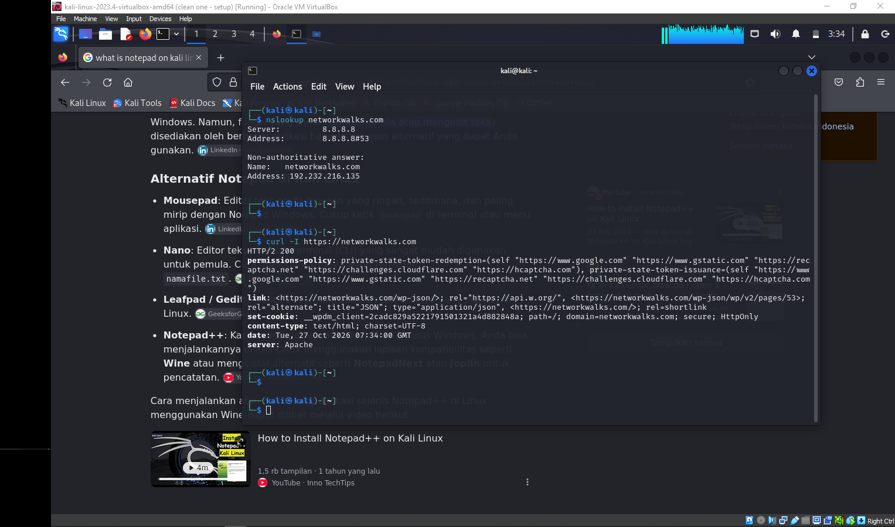
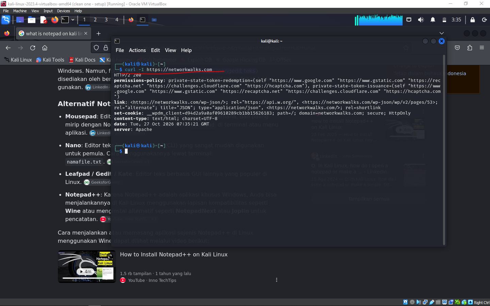
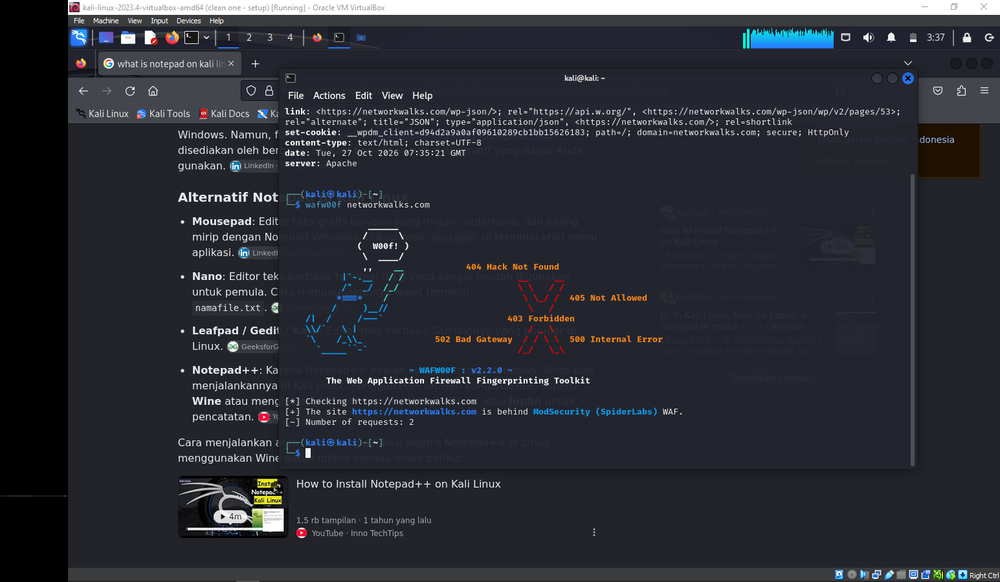
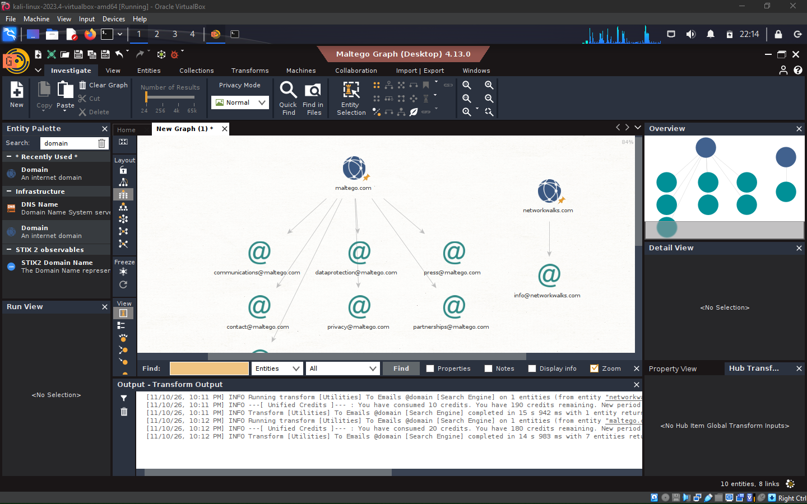
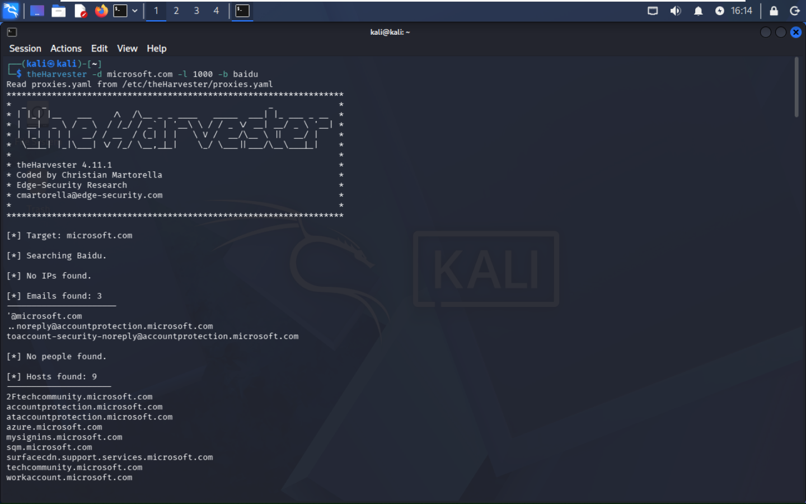
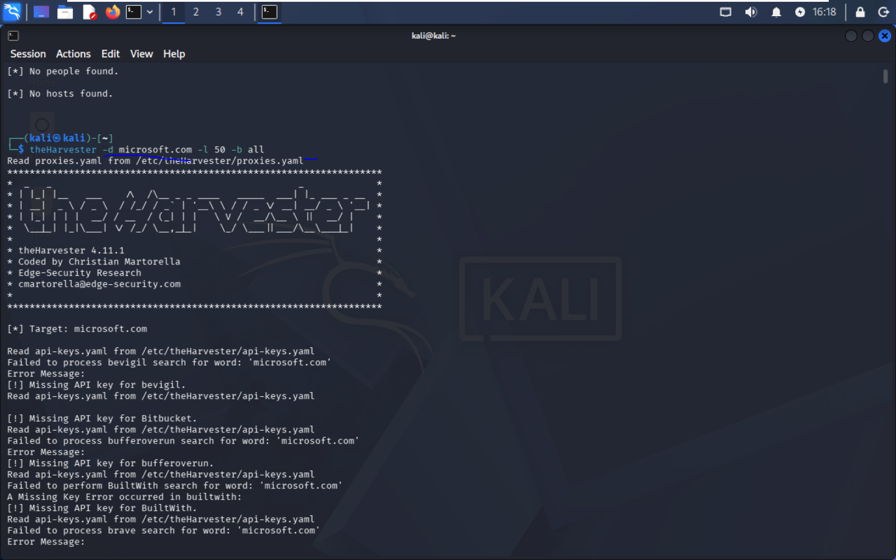

# **PENETRATION TESTING REPORT** 

FOOTPRINTING & NETWORK SCANNING PHASES 

W2-PM-FINAL | CYBERSECURITY |  NETWORKWALKS 

|**Pentester Name** **(Cybersecurity Professional)**|**Dheny Cahyono**|
|---|---|
|**Program/Batch**|B084-Networkwalks|
|**Date**|12 November 2026|
|**Modules completed**|W2-PM1 (Multiple Kali Tools) W2-PM5 (Zenmap Scanning)|
|**Client/Target**|1. Networkwalks (secured written permission already) 2. My own local LAN Network|
|**Permission secured from** **client?**|Yes|
|**Phases covered**|**Phase 1**  Reconnaissance & Footprinting **Phase 2**   Scanning & Network Discovery **Phase 3-5** In Progress|

----

## **1. Liability Disclaimer** 

I have performed these activities only on the systems & devices where I had secured written permission or the devices/systems that I own myself. All these materials are for education and research purpose only. Do not use anything from here to break the law. The instructor, the authors and Networkwalks are not responsible for what you do with this knowledge. Every action you take is your own responsibility. Misuse can lead to criminal charges, heavy fines, loss of your job and a permanent record. In most countries unauthorised access is a crime even when nothing is damaged. 

---

## **2. Introduction** 

This report covers footprinting the networkwalks.com domain using multiple Kali Linux tools (W2-PM1) and scanning my own local network with Zenmap (W2-PM5). One module covers the footprinting phase and the other covers the scanning phase, so together they show how an attacker moves from gathering public information to mapping live hosts on a network. It is the Week 2 part of my ongoing internship program at Networkwalks. 

All commands were run in Kali Linux (footprinting) and on a Kali Linux with Zenmap installed (scanning). Every step below includes the exact command used, the result I observed, a screenshot as evidence, and a short note on why the finding matters from an attacker's point of view. 

----

## **3. Tools Used** 

The table below lists each tool used in this report and its purpose. 

|**Tool**|**Purpose**|
|---|---|
|Kali Linux & Windows|Operating systems used for reconnaissance activities|
|WHOIS|Find domain registration details (owner, dates, name servers).|
|whatweb|Fingerprint web technologies (server, CMS, plugins, IP).|
|nslookup|Resolve the domain name to its IP address using DNS.|
|curl -I|Read the HTTP response headers of the website.|
|wafw00f|Detect whether a Web Application Firewall protects the site.|
|dnsrecon|Enumerate all DNS records (NS, MX, SPF, TXT, SRV).|
|Zenmap (Nmap GUI)|Scan the local subnet to find live hosts, IPs and MAC addresses.|

----

## **4. Activities Performed** 

### **4.1 Footprinting & Reconnaissance** 

I performed reconnaissance against the networkwalks.com domain using six Kali Linux tools: **WHOIS, WhatWeb, Nslookup, Curl, Wafw00f and DNSRecon** . Each tool was used to collect a different type of information about the target. 

First, I used **WHOIS** to obtain publicly available domain registration information and identify the domain’s name servers. The results provided information about the domain registration and hosting infrastructure. 

I then used **WhatWeb** to identify technologies used by the website. The results identified **WordPress 7.1.3** and **WP Download Manager 3.3.58** , **Juery 3.7.1** along with other information exposed by the website. 

Using **Nslookup** , I resolved the domain name to its IP address. The provided result identified **192.232.216.135** . 

I used **Curl** with the -I option to inspect the HTTP response headers. This provided additional information about the web application and exposed the WordPress REST API endpoint /wp-json/. 

Next, I used **Wafw00f** to determine whether a Web Application Firewall was protecting the website. The result identified **ModSecurity (SpiderLabs)** . 

Finally, I used **DNSRecon** to enumerate DNS records. The results provided information relating to name servers, mail servers, SPF/TXT records, service records and DNS software information. 

### **4.2 Network Scanning with Zenmap** 

For the second activity, I used **Zenmap** to perform network discovery on my local network. The practical required me to identify my local IP address and subnet, discover live hosts, identify their IP and MAC addresses, and generate a network topology. 

I first used the Windows ipconfig command to identify my local IP address and LAN subnet. I then entered the subnet into Zenmap and selected **Ping Scan** to identify active hosts. 

The example results provided in the practical identified four live hosts: 

- 192.168.2.2 

- 192.168.2.1 

- 192.168.2.254 

- 192.168.2.128 

After completing the scan, I opened the **Topology** section in Zenmap, enabled the legend and saved the network topology in PDF format as required by the practical task. 

----

## **5. Evidences Collected** 
**whois**

**whatweb**

**nslookup**

**curl -l**

**wafw00f**

**dnsrecon**

**Zenmap (Nmap GUI)**

**Maltego**

**theHarvester**

---

**👤 Author Dheny Cahyono** Intern Networkwalks B084 LinkedIn: https://www.linkedin.com/in/dheny-cahyono/ 

#### **👤 Project Information** 

**Program Name:** Cybersecurity program at Networkwalks | **Week:** 02 | **Repository:** GitHub 

Pentesting Project Report  |  Networkwalks  |  Page 3 

